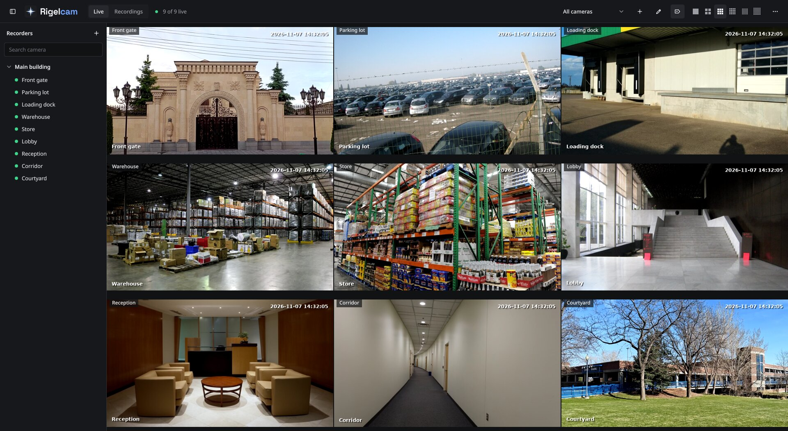
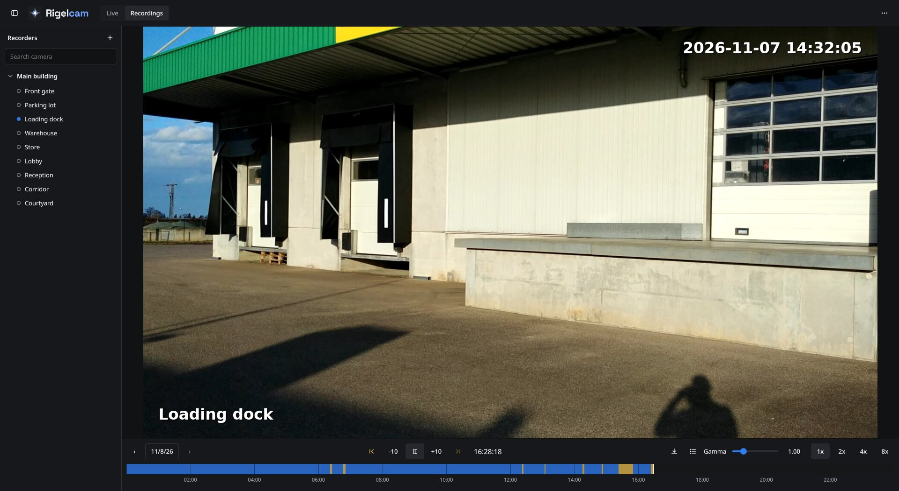
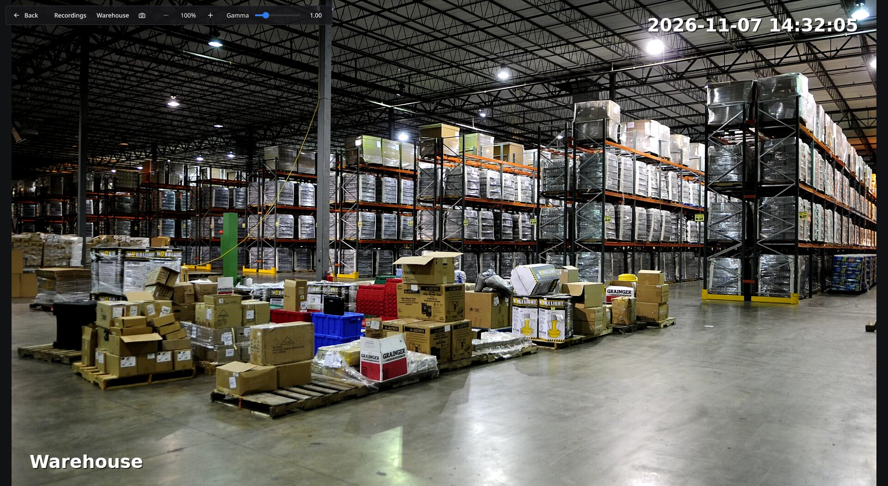
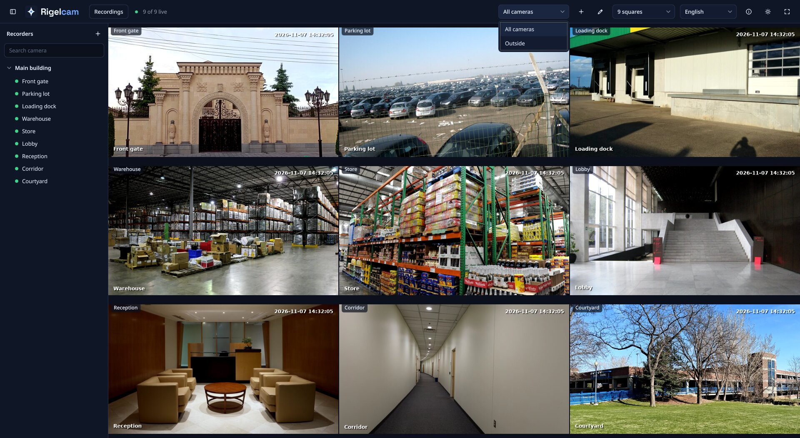
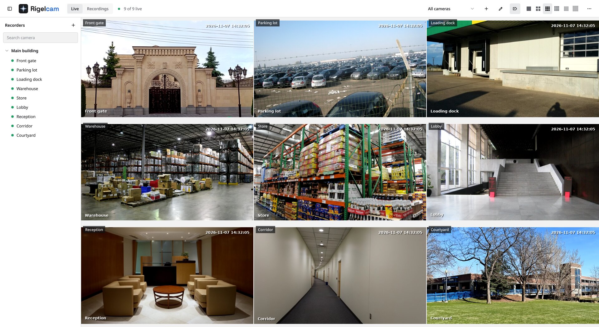

<p align="center">
  <picture>
    <source media="(prefers-color-scheme: dark)" srcset="assets/branding/logo-dark.svg">
    
  </picture>
</p>

<p align="center">English · <a href="README.pt-BR.md">Português</a> · <a href="README.es.md">Español</a></p>

Rigelcam is a desktop app for watching live cameras and browsing recordings on Intelbras and Dahua
NVRs, for Linux and Windows.

It talks to the recorder over the protocols the device already exposes, RTSP for video and the
Dahua HTTP API for everything else, so it does not need the vendor SDK and runs natively on Linux.

<p align="center"></p>

## Features

**Live view**

- Grid of cameras from one or more NVRs, using the substream so a full grid stays light
- Several named grids, switched from the toolbar or with Ctrl+PgUp and Ctrl+PgDown, and shown in
  turn on their own every 10 s, 30 s or minute if you want
- Double click to open a single camera on the main stream, with digital zoom and gamma
- RTX Super Resolution and RTX HDR on Windows with an NVIDIA RTX card, off by default
- Save a photo at the resolution of the video
- Hide the names over the grid, for cameras that print their own
- Channel names read from the recorder
- Cameras the user has no permission for are shown as such, without trying again

**Recordings**

- Timeline per channel for any day, with events such as motion marked apart from continuous recording
- Calendar with the days that have recordings
- Click anywhere on the timeline to play from that moment, at up to 8x
- Jump to the next or previous event, also with Ctrl+Right and Ctrl+Left
- Up to 4 channels played back in sync, each with its own digital zoom
- Export a clip to MP4, without re-encoding, limited to the recordings the user can play

The interface comes in English, Portuguese and Spanish, with dark and light themes.

## Screenshots

<p align="center">
  
  
</p>
<p align="center">
  
  
</p>

The cameras in these screenshots come from a test recorder that streams public domain and CC0 photos
from Wikimedia Commons.

## How it works

| What | How |
| --- | --- |
| Live video | RTSP, `/cam/realmonitor?channel=N&subtype=0\|1` |
| Recordings list | Session of the web API (`RPC2`), or HTTP Digest with `mediaFileFind.cgi` |
| Playback | RTSP, `/cam/playback?channel=N&starttime=...&endtime=...`, or `loadfile.cgi` for channels that refuse it |
| Export | HTTP Digest, `loadfile.cgi` |
| Device and channel info | HTTP Digest, `magicBox.cgi` and `configManager.cgi` |

Video is decoded by GStreamer on the graphics card, through VA-API on Linux and Direct3D 11 on
Windows, with no software decoder to fall back on. The core is written in Rust and the interface in Qt 6 Quick.

Some recorders answer 404 over RTSP for cameras with recent firmware, which still record normally.
Those channels play their recordings over HTTP and open live video directly from the camera, at the
address the recorder lists and with the login of the recorder. Only an address in the same /24
network as the recorder is used, so the password doesn't leave it.

Tested with the Intelbras NVD 1308 and NVD 7132. Other Dahua based recorders should work
the same way, reports are welcome.

Remote access through the Intelbras cloud (P2P) is out of scope. Use a VPN to reach the recorder
from outside its network.

## Credentials

Recorder passwords are kept in the system keyring (Secret Service on Linux, Credential Manager on
Windows) and never written to config files or logs. The Flatpak has no access to that keyring, and
keeps them in an encrypted file of its own, with a key from the Secret portal of the desktop.

On Windows the app asks GitHub for the latest version when it opens, and shows a notice if there
is one. Nothing is downloaded until you ask, and an installer only runs if its signature is valid.
Set `"check_updates": false` in `recorders.json` to turn the check off.

Video and HTTP traffic is not encrypted, so keep recorders on a trusted network. The RTSP library
answers a server that asks for Basic authentication, which sends the password in a reversible form.
Recorders use Digest, and the risk is a device on the network pretending to be one.

## Installing

Download from the [releases page](https://github.com/eduardoghi/rigelcam/releases). On Windows, the
installer updates the app by itself. On Linux, install the Flatpak bundle:

```sh
flatpak install --user rigelcam-*-linux-x86_64.flatpak
```

The bundle gets its runtime from Flathub and doesn't update by itself, so install each new version
the same way. Its data is apart from a build made from source, so add the recorders again.

## Building

You need Rust 1.98 or newer, Qt 6 with Qt Quick and the Linguist tools, and GStreamer 1.24 or newer
with its base, good and bad plugins.

```sh
cargo build --release -p rigelcam-app
```

The app is in `target/release`. On Linux, hardware decoding needs VA-API. On Windows, build from a
Visual Studio environment with `QMAKE` pointing at the `qmake` of an MSVC build of Qt, `PKG_CONFIG`
at the `pkg-config` of the official MSVC build of GStreamer, and the `bin` folders of both on the
`PATH`.

## Contributing

Enable the commit message and formatting checks once per clone:

```sh
git config core.hooksPath .githooks
```

Report security problems as described in [SECURITY.md](SECURITY.md).

## License

[MIT](LICENSE). The Space Grotesk font used in the logo is under the
[SIL Open Font License](assets/branding/SpaceGrotesk-OFL.txt).

The app uses Qt and GStreamer, which are available under the LGPL. A distributed build has to comply
with their licenses, and some GStreamer plugins have terms of their own.

## Disclaimer

Rigelcam is an independent project, not affiliated with or endorsed by Intelbras or Dahua.
Intelbras and Dahua are trademarks of their respective owners.
